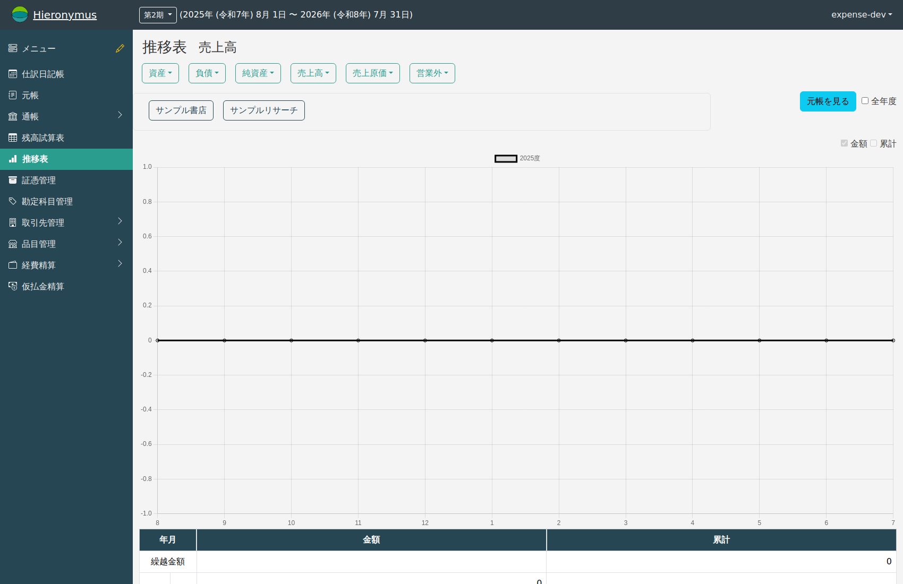

# クイックマニュアル: 経営層・社長向け（会計閲覧権限）

あなたに**会計閲覧権限**があるときの過ごし方です。数字を**見るだけ**の
権限です。編集・承認・取り込みは一切できません。それらは経理と承認者の
仕事です。

## あなたに見えるもの

左のメニューに、会計を「見る」ための画面が出ます。

| 画面 | 何が分かるか | 見るタイミング |
|---|---|---|
| **残高試算表** | 今期の全科目の残高と貸借の一致 | 月次 |
| **推移表** | 科目ごとの月次変動（売上の季節性・大きな支出） | 月次 |
| **仕訳日記帳** | 日々の伝票の一覧（未承認も見える） | 何か気になったとき |
| **元帳・通帳元帳** | 科目別・口座別の明細 | 疑問のある取引を追うとき |
| **通帳一覧** | 取り込んだ銀行・カード明細の状況 | 経理の進捗確認 |
| **予定表** | 資金繰り予定（月々の入出金計画） | 月次・年度計画 |
| **証憑管理** | 証憑（領収書等）の閲覧 | 必要なとき |

年度を選択してから（年度が未選択なら画面上部で選択します）、
メニューから開いてください。

## 使い方のこつ

- **月次は残高試算表と推移表だけ**で十分です。仕訳日記帳・元帳は
  「あの取引、なんだったっけ」と追跡するときの道具です
- 推移表は科目を選ぶと、月ごとの変動額と残高が一覧できます
  （例: 売上の季節性、大きな支出があった月）
- 通帳元帳は承認状態に関係なく明細を表示します。経理が突合を
  どこまで進めたかは通帳一覧で確認できます

## あなたにできないこと（悪しからず）

- 伝票・精算書・証憑の**編集・削除・承認**はできません
- 通帳の**取り込み**・学習ルールの変更もできません
- **年度の確定**は管理者（管理権限）の仕事です

数字の修正や承認が必要なときは、**経理に依頼**してください。
あなたの権限は「見る」ために設計されています（見るだけの人に
編集権限を渡さないのが、事故を防ぐ仕組みです）。

## よくある質問

**Q. 数字がおかしい気がする**
A. 仕訳日記帳で該当月を開き、あやしい伝票を探してください。
伝票の日付の下に通帳や経費精算へのリンクが出るので、取引の由来が
追えます。直す必要があれば経理に伝えてください。

**Q. 自分で承認もしたい**
A. 管理者に「承認権限」の付与を頼んでください。
[承認をする人のクイックマニュアル](approve-quick.md)を見て過ごすことになります。

**Q. 経理の作業が進んでいるか心配**
A. 通帳一覧で取り込みと突合の状況（未照合件数）が見えます。
承認待ちの伝票はホームの承認待ちカード（承認権限のある人に見えています）に
並びます。

**Q. 月次レポートが欲しい**
A. 帳票メニューから残高試算表・仕訳日記帳・総勘定元帳などのPDFが出力できます。
[会計帳票の出力](report.md)を参照してください。

---

経理側の作業の様子は[経理の日常](accounting-daily-quick.md)、突合の仕組みの
詳細は[通帳](bank-statement.md)を参照してください。
