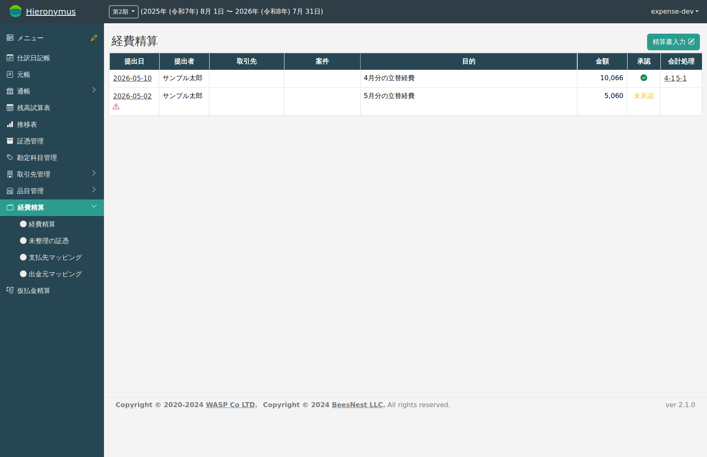
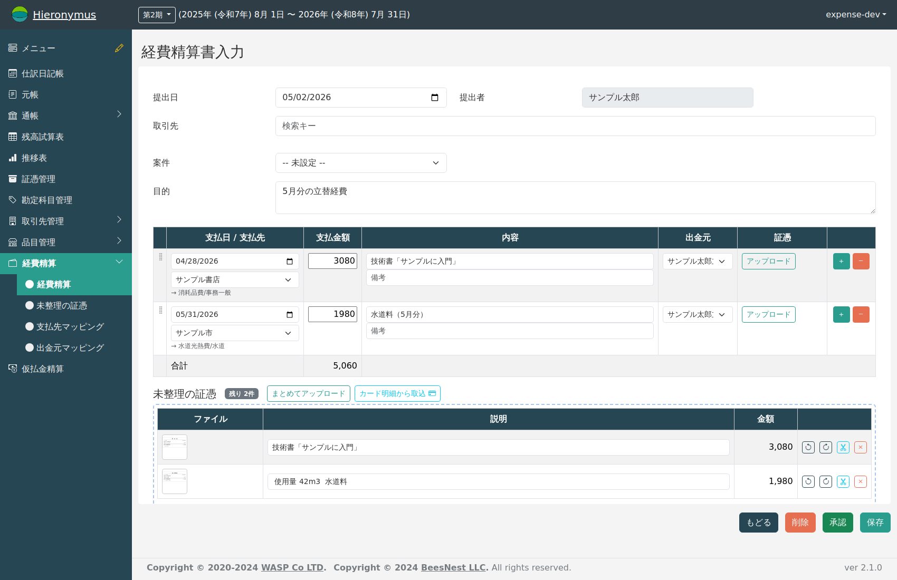
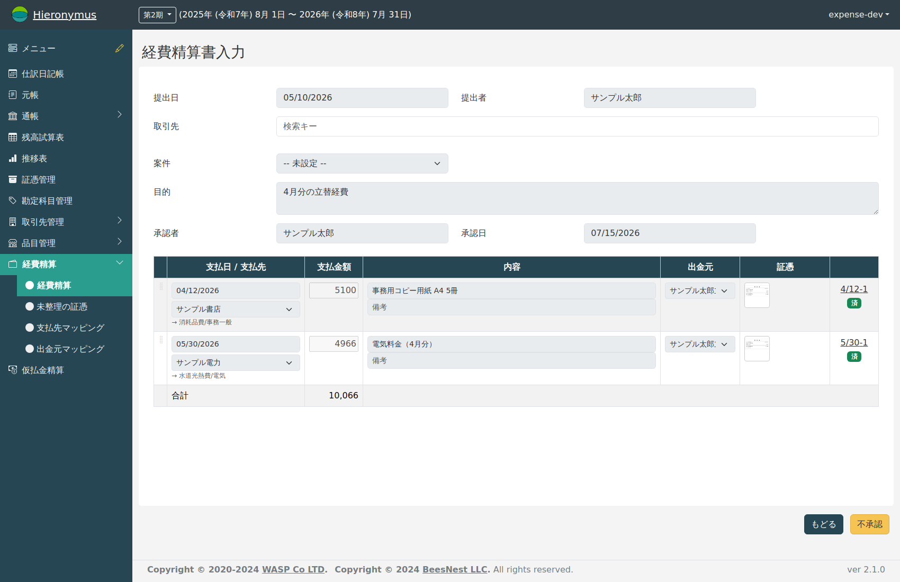
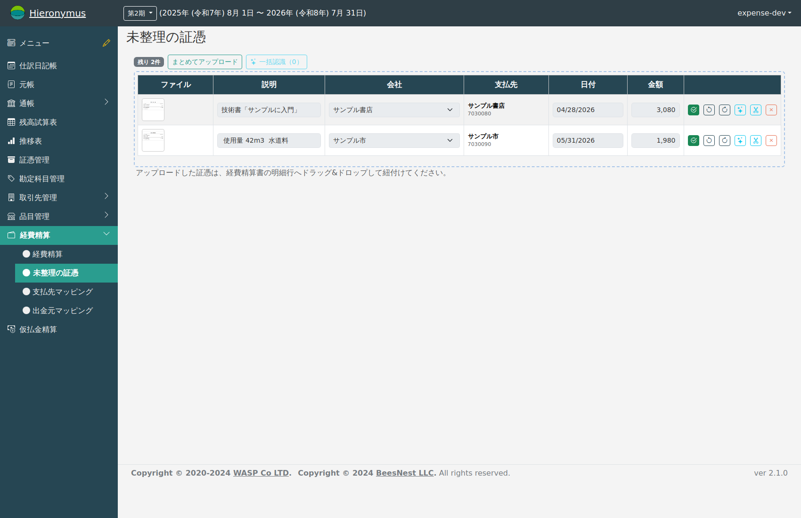
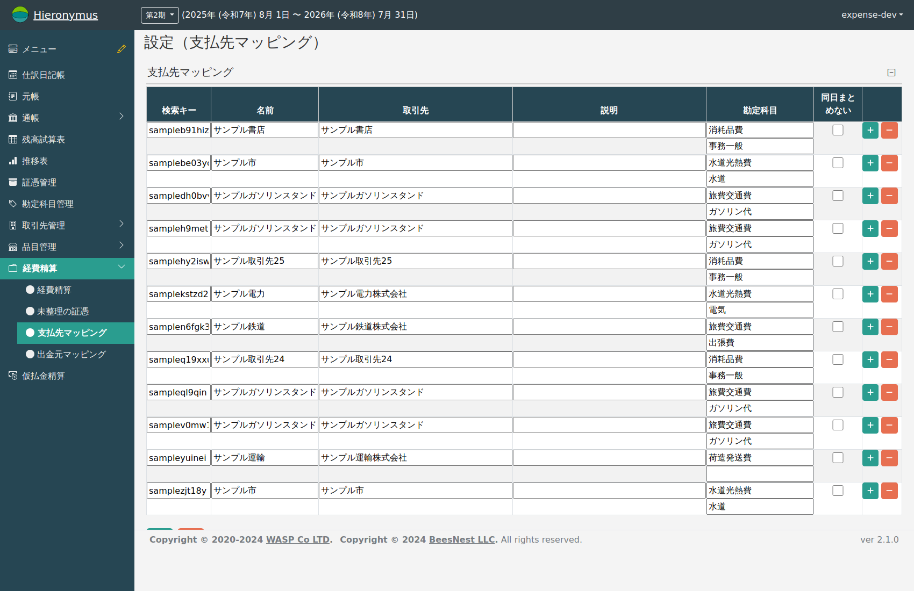
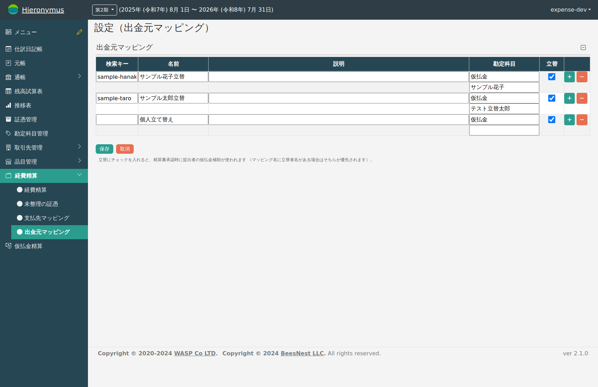
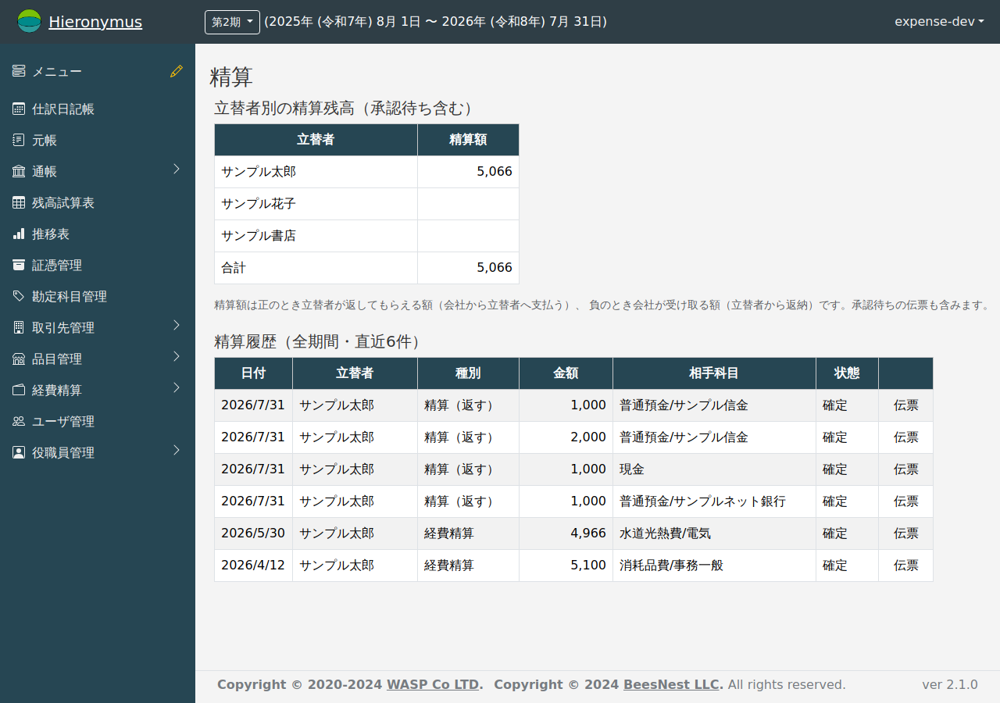
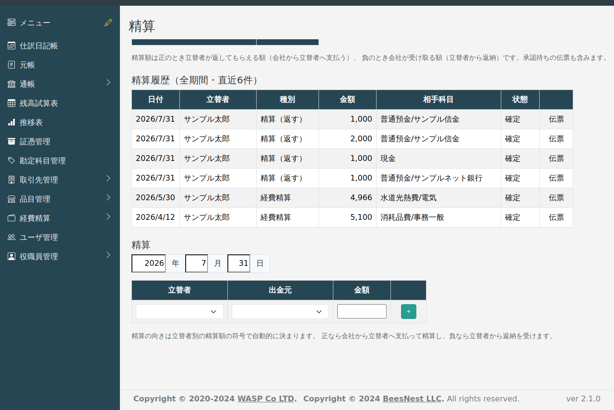

# 経費精算

経費精算は、一般従業員が会計の知識なしで経費の精算書を提出できるようにする機能です。

> **従業員で、精算書の出し方だけ知りたい場合**は
> [経費精算クイックマニュアル（従業員向け）](expense-quick.md)を参照してください。
> この文書は機能全体（経理向けの設定・精算処理を含む）の説明です。

## 画面の構成

経費精算メニューには次の4画面があります。

| 画面 | 説明 |
|---|---|
| 経費精算 | 精算書の一覧・入力 |
| 未整理の証憑 | どこにも紐付いていない証憑の管理（アップロード・認識・整理） |
| 支払先マッピング | 支払先と勘定科目の対応の設定 |
| 出金元マッピング | 支払い資金の設定 |

## 経費精算一覧

右下の「精算書入力」ボタンから新しい精算書を作ります。一覧には提出済みの精算書が並び、承認状態（承認済み ✓ / 未承認 ⚠）と、承認後に起票された仕訳伝票（`4/15-1` のような「月/日-番号」のリンク）を確認できます。

## 精算書の入力

ヘッダに提出日・取引先（任意）・案件（任意）・目的を入力し、明細行に支払日・支払先・内容・支払金額・出金元を入力します。

- 行の右端の「＋/－」ボタンで明細行を増減できます
- 証憑（領収書画像など）は未整理の証憑ページから**明細行へドラッグ&ドロップ**して紐付けます
- 支払先を選ぶと、そのマッピングで決まる勘定科目が行の下にヒント表示されます（`→ 消耗品費/事務一般` など）
- 明細は保存時に支払日順に自動ソートされます（同日内の並び順は ⋮⋮ハンドルのドラッグで調整できます）

### AI読み取り

証憑を紐付けた行の「AI読み取り」ボタンを押すと、証憑の画像をAIが読み取り、支払日・支払先・金額・内容を自動入力します。

- AIの設定が無い環境（`config/llms.yaml` のAPIキー未設定）では、このボタンは表示されません
- 抽出結果は必ず人間が確認できます（承認フローで経理が確認する）

## 承認

承認権限を持つユーザーが「承認」を押すと、明細が**伝票として起票**されます。明細の右端に伝票リンク（`4/12-1` などの「月/日-番号」）と承認状態バッジが表示されます。

- **会計権限を持つユーザーが承認した場合は、伝票も同時に確定します**
- 上長など会計権限の無い承認者の場合、伝票は承認待ちのまま残り、経理が仕訳日記帳で確定します
- 伝票は明細を「支払日 × 出金元」でグルーピングして複数枚に分けて起票します（1枚の精算書が複数の伝票になる。伝票日付はグループの支払日）
- 「不承認」を押すと精算書は修正可能に戻り、紐付伝票（未承認のもの）も承認待ちに戻ります

## 未整理の証憑

どこにも紐付いていない証憑を管理する画面です。

1. 「まとめてアップロード」かドラッグ&ドロップで、領収書などの画像・PDFを一括登録します
2. 登録した証憑は行ごとに確認・編集できます
   * **説明**: 証憑の内容（例: 技術書「サンプルに入門」）。証憑の検索・照合の手がかりになります
   * **会社**: 証憑の取引先。精算書の明細行へドラッグしたとき、支払先の自動選択に使われます
   * **日付・金額**: AI読み取りやOCRの結果を修正できます
3. 各行には操作ボタンがあります（承認済みの精算書と同列の操作）
   * ⭕: **OK済み**にします。OK済みの証憑は「もう誰も処理しない」という意思表示で一覧に薄く表示され、一括認識の対象から外れます（誰がいつOKしたかは記録され、もう一度押すと解除されます）
   * ↺↻: 画像の90°回転
   * ✨: **AI読み取り**。1枚ずつの認識で、証憑に会社・金額・日付を保存します（保存結果も画面上で確認・編集できます）
   * ✂: 複数の証憑が写っている場合に分離、1枚の場合は背景を除いて切り出します
   * →✕: 削除
4. 「一括認識」ボタンで、未処理の証憑を順次AIで読み取ります（進捗 `n/m` を表示。途中で中断できます）

## マッピング設定

支払先や出金元と実際の勘定科目の対応は「マッピング」で管理します（会計権限が必要）。

| 種別 | 例 | 用途 |
|---|---|---|
| 支払先 | サンプル書店 → 消耗品費/事務一般 | 精算画面で従業員が選ぶ「支払先」の選択肢そのもの。勘定科目・補助科目を決め、取引先を紐付けると証憑登録に必要な取引先も決まります |
| 出金元 | サンプル太郎立替 → 仮払金 | 承認時の伝票の貸方（支払い資金）を決めます |

**支払先マッピングの「説明」フィールド**: 同じ取引先でも買うものによって仕訳を変えたい場合（同じ書店でも書籍なら書籍費、事務用品なら消耗品費など）、同一会社で複数の支払先マッピングを登録し、「説明」欄に振り分けヒントを書きます。

- 説明は自由文。キーワードをカンマ区切りで書くと確実に照合されます（例: `書籍,本,コミック`）
- AI読み取りは、帳票の内容（取引内容）と説明が最も合うマッピングを選びます
- どの説明にも合わないときは、説明が空のマッピングを「デフォルト」として使います
- 「同日まとめない」にチェックを入れると、その支払先の行は承認時に1行1伝票として分離されます（同日の別振込を区別するため）

**出金元マッピングの「立替」フラグ**: チェックを入れると、その出金元から精算した金額は仮払金に積まれ、その補助科目（立替者）は提出者から自動で決定されます（マッピング名に立替者名がある場合はそちらが優先）。
提出者に対応する仮払金の補助科目が存在しない場合、承認時の起票はエラーになります。
立替フラグの無い出金元（法人カードや社用銀行口座）を選ぶと、精算の必要が無い支払として直接その科目から支払われた扱いになります。

## 勘定科目・補助科目の対応

マッピングの「勘定科目」列には主要な科目を、補助科目欄には例えば立替者の名前を設定します。

## 精算（立替精算）

経費精算で承認・起票された仕訳は、精算対象額を精算科目（既定は仮払金）の補助科目（立替者別）に積み上げます。
「経費精算」メニューの「立替精算」（会計権限）では、立替者別の精算額を確認し、精算の伝票を起票できます。

精算額は貸借の用語を使わず、「結局いくら返す/もらうのか」で表示します。
正の値は**立替者が返してもらえる額**（会社から立替者へ支払う）、負の値は会社が受け取る額（立替者から返納）です。

| 項目 | 説明 |
|---|---|
| 精算日 | 精算伝票の日付（表示中の期の範囲内。年度外の精算はできません） |
| 立替者 | 精算科目の補助科目（立替者） |
| 出金元 | 支払い資金または受け入れる口座（現金・普通預金口座） |
| 金額 | 精算金額 |

精算の向き（返す/もらう）は入力させず、立替者別の精算額の符号から自動的に決まります
（精算額が0の立替者は精算の対象になりません）。

立替者別の精算額は全期間を通算した現在高です（期をまたぐ精算も正しく相殺されます）。
精算科目のクラス（資産/負債）は表示に影響しません（資産の仮払金でも負債の立替金でも「貸方残=返すべき」になります）。
画面には「精算履歴（全期間・直近30件）」も表示され、各行から伝票個別画面へ、
立替者名から補助元帳へ移動できます。

起票された伝票は仕訳日記帳に追加され、承認フローで確定します（承認権限を持つユーザーの起票は即時に確定します）。
起票すると伝票個別画面に移動し、「もどる」で精算画面に戻ります。

## AIエージェントからの操作

`expense-mcp` により、マッピングの追加/変更/删除/取得や精算情報の取得/更新が可能です。
詳しくは[AI連携](ai-integration.md)を参照してください。

## 精算書と伝票の関係（1:n）

- 経費精算書を承認すると、明細を「支払日 × 出金元」でグルーピングし、
  グループごとに仕訳伝票を起票する（1枚の精算書が複数の伝票になる）
- 伝票の日付はグループの支払日（通帳・銀行明細との突合キー）
- 支払先マッピングに「同日まとめない」（noBundle）を付けると、
  その支払先の行は同日・同出金元でも1行1伝票として分離される
  （同日の別振込を区別するため）
- 明細は保存時に支払日順でソートされる（同日内のコマ順は並べ替えで
  調整できる。明細行・伝票明細とも ⋮⋮ハンドルでドラッグ）
- 紐付けは伝票側の `expenseReportId`（1:n）。精算書を不承認して再承認
  すると、未承認の紐付伝票は削除して作り直す（承認済みの伝票は残る）。
  精算書の画面からは伝票ごとに削除できる
- 逆方向の導線もあり： **仕訳日記帳**では精算書に紐付いた伝票の日付の下に
  「経費精算」リンクが表示され、元の精算書の入力画面へ移動できる。
  伝票個別画面にも「この伝票は経費精算書から管理されています」のバナーが表示される
  （「この伝票はどの精算だっけ？」は[仕訳明細](crossslip.md)から答えられる）

## カード明細からの精算（個人カード）

立替払いで個人カードを使った場合、精算対象は明細の一部（メモ等で印を付けた行）です。

1. 精算書入力画面の「カード明細から取込」で個人カードの明細を取り込みます
2. 精算対象の行にチェックを付け（メモ欄の記載がある行は既定でチェック）、支払先を選んで「精算書に追加」します
3. 追加された行は通常の精算明細と同じフロー（保存→承認→起票）で処理されます

## 承認時の伝票統合（出金仮との1本化）

承認で起票された伝票が、**カード・銀行の明細取り込みで仮起票された伝票と同じ取引**を指すときは、**起票の瞬間に1本にまとめます**。

- 精算書側の伝票が**残り**、仮起票側（借方 出金仮1900000）は廃棄されます。伝票日付は精算明細の支払日を生かします
- カード明細の取り込み行の照合先が、その精算書伝票に付け替わります（「未照合」のまま残った行が前後で復元される）
- 候補が複数になったり条件が合わなかったりした場合は統合せず、伝票が2本のまま残ります。その場合は仮起票側の伝票を「削除」してから、取込行を精算書伝票と突合してください

仕組みの詳細は[通帳](bank-statement.md)の「伝票統合」を参照してください。

## 未整理の証憑ページとマッピング設定ページ

- 「未整理の証憑」（`/expense/unsorted`）: どこにも紐付いていない証憑の
  一覧。アップロード・説明入力・回転・分離・削除がここでできる。
  経費精算書の明細へドラッグ&ドロップで紐付ける
- 支払先マッピング（`/expense/payee`）/ 出金元マッピング
  （`/expense/payment`）: それぞれ1テーブルの設定ページ。
  旧URL（`/expense/home`）は支払先マッピングに誘導される

### 精算の「出金元」について

精算の資金の出どころ（銀行口座・現金等）は、**決定的なドロップダウンリスト**から直接選択します（マッピングを経由しません）。

- リストには「現金」「普通預金/口座名」等が固定で並びます（資産科目のうち現金・預金に属するもの。例外的な科目が増えた場合は将来拡張）
- 仕訳は「返す（会社 → 立替者）」なら借方=精算科目/立替者・貸方=選んだ口座、「もらう（立替者 → 会社）」ならその逆
- 経費精算には使わない「精算専用口座」を用意して、普段の精算と分ける運用にも対応できます
- 旧仕様の「出金元マッピング」は上記の直接選択に置き換えられたため、出金元マッピング設定の行は精算では参照されません（経費精算承認時の伝票貸方には引き続き使用されます）
