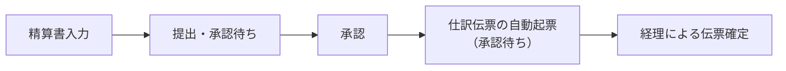

# 経費精算

経費精算は、一般従業員が会計の知識なしで経費の精算書を提出できるようにする機能です。

## 基本的な流れ

1. 従業員が「経費精算」画面から精算書を入力して提出します
2. 承認権限を持つユーザーが承認すると、**仕訳伝票が自動で起票**されます（起票直後は承認待ち）
3. 経理担当者が仕訳日記帳から起票された伝票を確認し、承認して確定します

なお、**立替金の精算（仮払金→預金の振替）は直ちには行われません**。承認時の起票は「経費 → 仮払金」の仕訳で精算対象額を仮払金に積むだけです。戻し入れは別途、既存の伝票入力で行ってください。

## 精算書の構成

### ヘッダ

| 項目 | 説明 |
|---|---|
| 提出日 | 精算書の提出日（自動起票される伝票の日付にもなります） |
| 提出者 | 精算を受ける人（本人） |
| 取引先 | 精算業務に関連する取引先（任意） |
| 案件 | 精算が属する案件（任意） |
| 目的 | 出張や購入の目的（任意） |

### 明細

| 項目 | 説明 |
|---|---|
| 支払日 | 支払った日 |
| 支払先 | 支払った相手（経理が登録した支払先マッピングから選択。件数が少ないので単純な選択式） |
| 内容 | 何の支払いか（自由記述。伝票の摘要になります） |
| 支払金額 | 支払った金額（税込） |
| 出金元 | 支払い資金の出どころ（マッピングから選択） |
| 備考 | 補足情報 |
| 証憑 | 領収書等の電子化証票。原則的に1明細1証憑を添付します |

### 精算について

この画面では立替精算（仮払金→預金の振替）は行いません。精算は「仮払金精算」画面で、
仮払金の補助科目（立替者）別の残高に対して別途行います。

## 仮払金精算

経費精算で承認・起票された仕訳は、精算対象額を仮払金の補助科目（立替者別）に積み上げます。
「仮払金精算」メニュー（会計権限）では、立替者別の残高を確認し、精算の伝票を起票できます。

| 項目 | 説明 |
|---|---|
| 精算日 | 精算伝票の日付 |
| 立替者 | 仮払金の補助科目（立替者） |
| 方向 | 「返す」= 会社から立替者へ精算する（仮払金 → 出金元）。「もらう」= 立替者から会社へ返納する（入金先 → 仮払金） |
| 相手科目 | 「返す」なら出金元（銀行口座等）、「もらう」なら入金先（現金等） |
| 金額 | 精算金額 |

起票された伝票は仕訳日記帳に追加され、承認フローで確定します（承認権限を持つユーザーの起票は即時に確定します）。

## マッピング

支払先や出金元と実際の勘定科目の対応は「マッピング」で管理します（メニュー: 経費精算 → 設定。会計権限が必要）。

| 種別 | 例 | 用途 |
|---|---|---|
| 支払先 | Amazon → 旅費交通費 | 精算画面で従業員が選ぶ「支払先」の選択肢そのもの。勘定科目・補助科目を決め、取引先を紐付けると証憑登録に必要な取引先も決まります |
| 出金元 | 個人立て替え → 仮払金 | 承認時の伝票の貸方（支払い資金）を決めます。複数の銀行・クレジットカードも登録できます |

「個人立て替え」には**立替フラグ**を付けます。立替系の出金元から精算した金額は仮払金に積まれ、その補助科目（立替者）は提出者から自動で決定されます。
提出者に対応する仮払金の補助科目が存在しない場合、承認時の起票はエラーになります。

※立替フラグの無い出金元（法人カードや社用銀行口座）を選ぶと、精算の必要が無い支払として直接その科目から支払われた扱いになります。

## AI読み取り

証憑をアップロードした後、明細の「AI読み取り」ボタンで証憑の画像/PDFをAIに読み込ませ、支払先・金額・日付・内容を自動入力できます。

- AIの設定が無い環境（`config/llms.yaml` のAPIキー未設定）では、このボタンは表示されません
- 抽出結果は必ず人間が確認できます（未承認 → 承認のフロー）

詳しい設定は[AI連携](ai-integration.md)を参照してください。

## AIエージェントからの操作

`expense-mcp` により、マッピングの追加/変更/删除/取得や精算情報の取得/更新が可能です。
詳しくは[AI連携](ai-integration.md)を参照してください。
