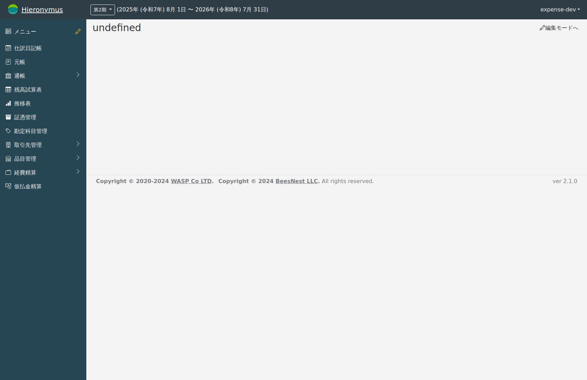

# マイページ

Hieronymusには、自分専用のページ（マイページ）を作る機能があります。
複数の情報を1ページにまとめて置ける「自分用のダッシュボード」です。

* 左サイドバーの**マイページ**に追加したページが並びます
* 置けるのは、ページへのリンク・帳票出力・承認待ち・メモ・ブックマークなど（ウィジェット）
* テンプレート（ホーム／会計メニュー／顧客管理／人事管理／システム管理等）から
  始めるので、ゼロから考える必要はありません

マイページはユーザーごとのもので、他の人には影響しません。

## マイページを追加する

左サイドバーの「マイページ」の右にある**鉛筆のアイコン**をクリックすると、編集モードになります。

編集モードでは「＋」「✓」のボタンが現れ、追加や並べ替えができるようになります。

.png)

「＋」をクリックすると、テンプレートの一覧が表示されます。

.png)

たとえば、「ホーム」を選択すると、トップメニューと似た雛形が表示されます。

.png)

「保存して終了」をクリックします（保存して実行モードへ戻ります）。

.png)

左メニューに「ホーム」が追加されました。

.png)

マイページのタイトルを変更したい場合は、タイトルを編集します。
**「編集を終える」を押したときにも自動保存される**ので、
保存し忘れて変更が消えることはありません。

.png)

「保存して終了」をクリックすると、保存してマイページ表示に戻ります。

.png)

## ウィジェットを追加・調整する

ウィジェット（表示される項目）を追加したい場合は、「ウィジェットを追加」をクリックして、

.png)

追加したいウィジェットを**ドラッグ＆ドロップ**します。

.png)

ウィジェットの位置を変更したい場合は、タイトルをドラッグします。

.png)

大きさを変更したい場合は、ウィジェット右下をドラッグします。

.png)

ウィジェットの高さより中身が多い場合（種別管理の行が増えた場合など）は、
ウィジェットの中をスクロールできます。大きさを変えなくても
ボタンや行はすべて操作できます。

左サイドバーの項目もドラッグ＆ドロップで置けます（リンクとして追加されます）。

保存して「**編集を終える**」をクリックすると、実行モードとなって編集できなくなります。

.png)

編集中の間は画面上部に「編集中」のバナーが表示されます。
なお、左サイドバーのマイページ編集（鉛筆アイコン）は「ページの追加・並べ替え・削除」、
ここの編集モードは「このページの中身（ウィジェットの配置）」の編集です。

この画面は左メニューをクリックするといつでも表示されます。

.png)

## 便利なウィジェット

ウィジェットには、ホーム画面等に表示されているものの他に、「メモ」があります。

.png)

承認権限を持つユーザーは「承認待ち」（承認待ちの仕訳伝票）と
「経費精算の承認待ち」（承認待ちの経費精算）のウィジェットを置けます。
いずれも未承認が0件のときは「ありません」と表示されます。

メモは、「保存して終了」することで保存されます。
通常のメモと言うよりは、どちらかと言えば静的なことを書いておくことに使うのが良いでしょう。

また、**ブラウザの任意のURLをドラッグ＆ドロップ**することで、そのURLへのリンクを追加することができます。

.png)

このようにYouTubeの**URLをドラッグ＆ドロップ**することで、サムネイルを置くことができますが、一番の目的は「Hieronymus上の任意の状態へのリンク」を張ることです。

.png)

内容を修正したい場合は「鉛筆」アイコンをクリックすれば編集できます。

.png)

URLに意味のあるページにリンクが作れますから、たとえば

* 特定の勘定科目の元帳
* 特定の売上の推移表
* 特定のプロジェクトの集計表示

といったものが直接に開くリンクが張れます。

## 管理者による公開

管理者権限を持つユーザーは、編集モードで「**テンプレートとして公開**」ボタンを使えます。
これを押すと、そのマイページが**テンプレートとして全ユーザーに公開され**、
どのユーザーも「＋」の一覧から追加して使えるようになります。

* 公開はコピーを作る操作です。元のマイページはそのまま残ります
* 公開したテンプレートは管理者なら削除できます（マイページの×から）
