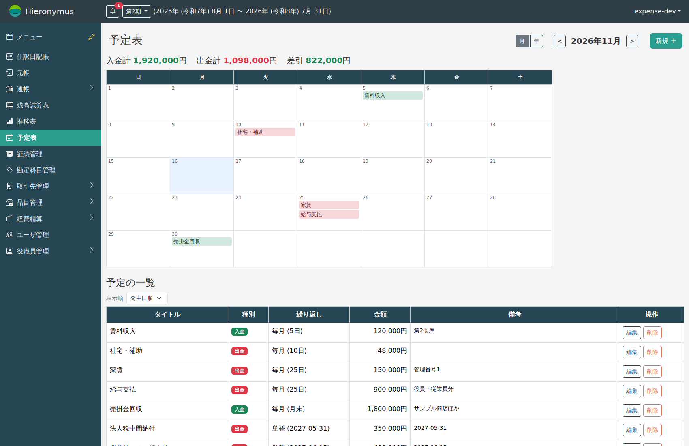
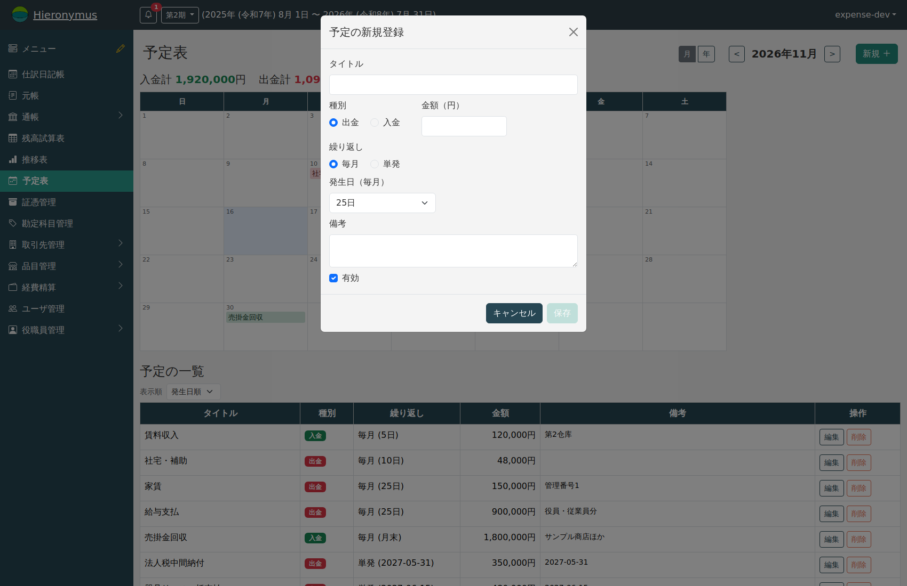

# 予定表

予定表は、月々の決まった入出金や、資金繰りに影響する入出金の予定を管理する機能です。

* **申し送りではなく資金繰りが目的**: 「家賃」「給与支払」「売掛金の回収」のような、
  月次の定常的な入出金と、単発の入出金予定（決算関連の納付など）を管理します
* **カレンダーは既存のものを使う**: 予定は本システムで管理しますが、カレンダーとしての
  表示・リマインドはお使いのカレンダー（Googleカレンダー、グループウェア等）に
  ICSフィードで配信します。別系統のカレンダーシステムを作ることはありません

## 権限

* 閲覧: 会計権限・会計閲覧権・管理権限を持つユーザー
* 編集（追加・変更・削除）: 会計権限・管理権限を持つユーザー

## 月ビュー（カレンダー）

メニューの「予定表」を開くと、当月のカレンダーに予定が表示されます。

* カレンダーのセルに、その日の予定が表示されます
  （緑=入金、赤=出金。マウスを重ねると金額も出ます）
* 予定をクリックすると編集モーダルが開きます
* 上部に**入金計・出金計・差引**の月計が表示されます。手元資金の見通しの
  目安として使えます（実残高との突合は今後の機能です）
* 「<」「>」で月を移動します。単発の予定はその月にだけ表示されます

.png)

## 年ビュー

「月 / 年」の切替で「年」を選ぶと、12ヶ月分の入金計・出金計・差引の一覧と
年計が表示されます。年間の資金繰りの見通しを確認できます。

.png)

* 月名をクリックすると、その月のカレンダーに移動します
* 現在の処理月がハイライトされます

## 予定の登録・編集

「新規」ボタンで登録モーダルが開きます。予定の一覧から「編集」「削除」もできます。

* **タイトル**: 予定の名前（家賃、給与支払など）
* **種別**: 出金 / 入金
* **金額**: 円で入力します
* **繰り返し**:
  * **毎月**: 発生日を1〜31日から選びます。「月末」も選べます。
    31日のように月に存在しない日は、その月の末日に繰り上げられます
    （2月なら28日/29日）
  * **単発**: 発生日を日付で指定します。その月にだけ表示されます
* **備考**: 口座名や相手先など、自由にメモを書けます
* **有効**: チェックを外すと予定が一時停止します（削除せずに一覧から外せます）

## 予定の一覧

登録済みの予定を一覧で確認できます。「表示順」を切り替えられます:

* **発生日順**: 毎月の予定は発生日順、単発の予定はその日付順
* **金額順**: 金額の大きいものから
* **種別順**: 入金・出金ごとに、金額の大きいものから
* **登録順**: 登録した順

一覧の表示順は好みに合わせて切り替えて使ってください（保存はされません）。

## カレンダーへの購読（ICSフィード）

ページ下部に購読用URLが表示されます。このURLをGoogleカレンダーやグループウェアの
「URLで追加」（他のカレンダーを追加）に登録すると、予定がカレンダーに表示されます。

* 予定は**終日イベント**として表示されます（タイトルの先頭に入/出が付きます）
* フィードは先月から12ヶ月先までの予定を配信します
* 予定を変更すると、カレンダー側にも自動で反映されます（購読の更新頻度は
  カレンダー側の設定によります）

### 購読URLの扱い

購読URLにはトークン（ランダムな文字列）が含まれています。このURLを知っている人は
予定表を購読できるため、**取り扱いに注意してください**。

* 「再生成」を押すと現在のURLは無効になり、新しいURLが発行されます
  （購読していたカレンダーはURLを設定し直す必要があります）
* トークンはユーザーごとに発行されます。権限のないユーザーのトークンでも、
  フィード自体は同じ（会社単位の）予定を返します

## 補足

* 予定と実績（通帳・仕訳）の突合（「この予定はすでに起票済みか」の消し込み）は、
  今後の機能として計画されています
