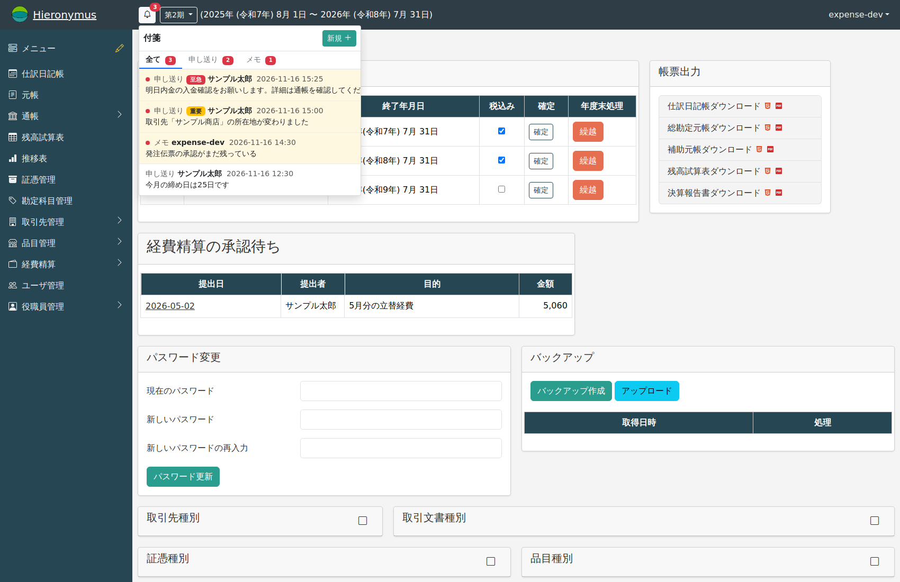
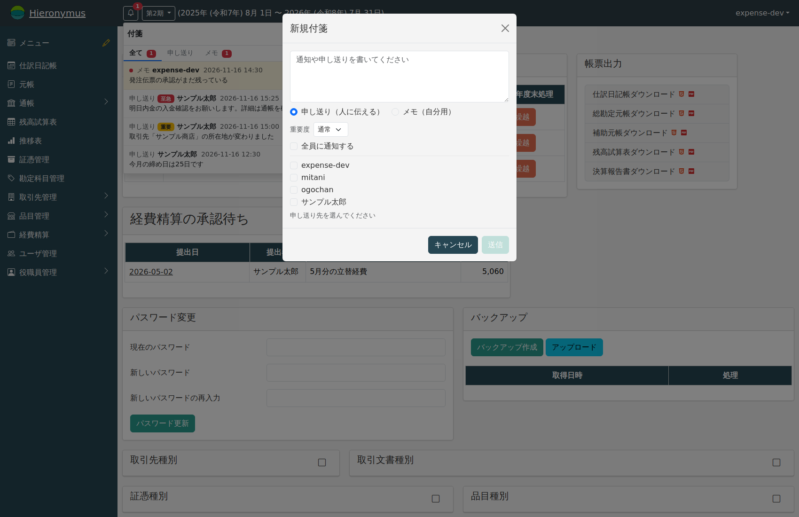
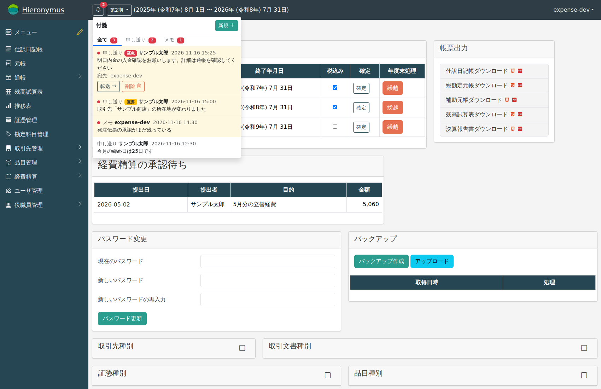
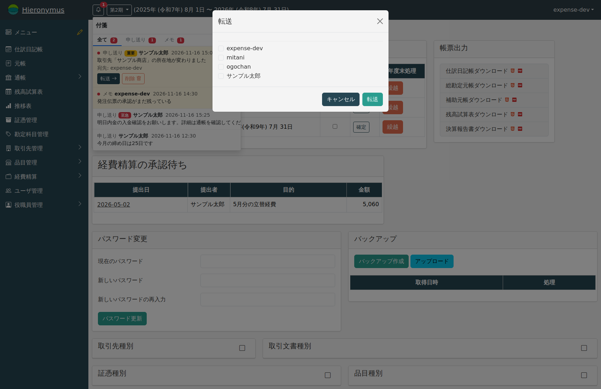

# 付箋・申し送り（Sticky）

付箋・申し送り機能は、通知や申し送りを書いて自分や他のユーザーに伝えるための機能です。「画面に付箋紙を貼る」感覚で使える、軽量なメッセージ機能です。

* **申し送り**: 他人に伝えるメッセージ。宛先を選んで送ると、相手の画面に未読として通知されます
* **メモ**: 自分用のメモ（TODO的な使い方）。自分にしか見えません

## 通知の見方

画面上部（会計年度を表示しているバー）にベルのアイコンがあります。未読の付箋があると、ベルに未読数のバッジが表示されます。付箋の有無はどのページにいても確認でき、新しい付箋は自動で通知されます。

.png)

ベルをクリックすると付箋の一覧パネルが開きます。

* 一覧は「未読 → 重要度 → 新しい順」で並びます
* 未読の付箋はハイライトされ、赤い点が付きます
* 付箋をクリックすると本文が開き、未読であれば自動的に既読になります

各行には、種別（申し送り/メモ）、重要度のバッジ（重要=黄、至急=赤）、書いた人、日時、本文のプレビューが表示されます。

## パネルのタブ

パネル上部に「全て / 申し送り / メモ」のタブがあります。各タブに未読数が表示されます。

* **全て**: 自分に関係する付箋すべて
* **申し送り**: 人に伝える付箋（自分宛に届いたもの、自分が送ったもの）
* **メモ**: 自分用のメモ

.png)

## 付箋を書く

パネルの「新規」ボタンで作成モーダルが開きます。

* **種別**: 「申し送り（人に伝える）」か「メモ（自分用）」を選びます
  * 申し送りの場合は宛先を選びます（複数選択可。「全員に通知する」も選べます）
  * メモの場合は宛先の指定がなく、自分だけが見られます
* **重要度**: 通常 / 重要 / 至急。重要度が高い付箋は一覧で上に来て、
  バッジ（重要=黄、至急=赤）が付きます
* 本文を書いて、申し送りは「送信」、メモは「保存」します

メモを選ぶと、宛先の指定は不要になります。

.png)

宛先は、ユーザーに登録されている人から選びます。全員に一斉通知することもできます。

## 付箋の操作

一覧で付箋をクリックすると本文が開き、未読であれば既読になります。

開いた付箋に対して、次の操作ができます。

* **削除**: 自分宛に届いた付箋を自分から消します（他の人には残ります）。
  自分が書いた付箋（受信していないもの）は本体ごと消え、全員から消えます
* **転送**: 受け取った付箋を別のユーザーにそのまま転送します。
  メモを転送すると申し送りになります

## 付箋の寿命

付箋は削除しない限り残り続けます。「いつでも見返せる付箋」として使ってください。既読になっても一覧には残ります（未読のものが上に並びます）。

## 付箋は送った後には編集できません

付箋を編集できるのは**出すまで**です。送信した付箋の本文を後から書き換えることは
できません。これは、既読になった付箋が黙って書き換わっても読み手が気づかない、
という事故を避けるための設計です。訂正したい場合は、その付箋を削除して
書き直してください。

## よくある使い方

* **申し送り**: 「伝票の確認をお願いします」「明日の入金の件」など、
  引き継ぎや連絡事項を相手に通知する
* **メモ**: 「この取引は要確認」のような自分用のTODO。宛先を選ばずに
  保存すれば自分だけの付箋になり、未読の間はベルに表示され続ける
* **全員宛**: 「本日15時から打ち合わせ」のような、全スタッフへの案内
